# QuotaGuard — Zero-Root Android Wi-Fi Quota & Bandwidth Enforcement System

-3DDC84?style=flat-square&logo=android&logoColor=white)

-FFCA28?style=flat-square&logo=firebase&logoColor=black)

**QuotaGuard** is a production-grade Android network governance and shared-router bandwidth control system engineered in **Kotlin** with **Native TUN-to-SOCKS5 Proxying**. It enables network administrators to onboard members onto a Wi-Fi router without sharing the plaintext password, assign strict gigabyte quotas, throttle traffic in real time down to the kilobit level, and trigger automated cutoffs—all **without root access, custom router firmware, or paid cloud servers**.

> [!NOTE]
> **Showcase Repository:** To safeguard proprietary network enforcement mechanics and production Firebase configurations, the full source code is maintained in a **private repository** and is available for live code walkthroughs during technical interviews.

---

## Live Demo & Visual Showcase

> **Demo Video:** *[Upload your 60–90s recorded walkthrough MP4/GIF or YouTube Unlisted link here]*

### Precision Utility UI (Daylight & Neutral Carbon Dark Mode)

| Role Selection (Light) | Role Selection (Dark) | Admin Quota Dashboard | Member Live Enforcement |
| :---: | :---: | :---: | :---: |
| *Add `screenshots/01_role_light.png`* | *Add `screenshots/02_role_dark.png`* | *Add `screenshots/03_admin_group.png`* | *Add `screenshots/04_member_view.png`* |

*(See [`screenshots/CAPTURE_GUIDE.md`](./screenshots/CAPTURE_GUIDE.md) for the exact shot list and demo recording script.)*

---

## System Architecture

```mermaid
flowchart LR
    Admin["Admin Device (Group Policy & Radar)"] -->|RTDB State & FCM v1 Wakeup| Cloud["Firebase Realtime DB & FCM HTTP v1"]
    Cloud -->|High-Priority Push / Sync| Watcher["WatcherService (Android 10-16 Resilient)"]
    Watcher --> FP["NetworkFingerprintManager (No Location Perm)"]
    FP -->|Home Router Matched| Engine["QuotaEnforcementEngine"]
    FP -->|Outside Home Wi-Fi| SafeStop["Auto-Suspend VPN (Zero Interference)"]
    Engine -->|SLOWDOWN / APP_LOCK / KILL_SWITCH| VPN["QuotaVpnService + HevTunnelManager"]
    VPN -->|tunFd| Socks["Local Socks5Server (127.0.0.1:10808)"]
    Socks -->|TokenBucket Shaping + QUIC UDP-443 Drop| Net["Filtered Outbound Traffic"]
```

---

## Core Engineering Challenges Solved

### 1. Zero-Root Encrypted Wi-Fi Gate (`WifiGateManager`)
* Onboards members onto a router via **`AES-256-GCM` encrypted offline QR payloads (`QGWIFI:`)** paired with Android 10+ `WifiNetworkSuggestion` (`.setCredentialSharedWithUser(false)`).
* Eliminates plaintext Wi-Fi password leaks and disables OS-level QR credential sharing while automatically revoking suggested credentials upon group removal or tamper detection.

### 2. Real-Time Bandwidth Shaping (`QuotaVpnService` + `HevTunnelManager` + `Socks5Server`)
* Bridges Android `VpnService` (`tunFd`) through `hev-socks5-tunnel` (`TProxyService`) into a bounded-pool local Kotlin `Socks5Server` (`127.0.0.1:10808`, `ThreadPoolExecutor` 8–32 daemon workers, `LinkedBlockingQueue(256)`).
* Implements a thread-safe **Token Bucket** (`TokenBucket`) byte-stream rate limiter with sub-second pacing and ~200 ms burst smoothing to induce natural TCP backpressure without random packet loss (`SLOWDOWN`), entertainment app isolation (`APP_LOCK`), and total cutoff (`KILL_SWITCH`).
* **QUIC Interception:** Actively drops UDP packets on port `443` while passing DNS (`53`) unthrottled, forcing QUIC/HTTP3-heavy apps (YouTube, TikTok) back onto TCP `443` for deterministic throttling.

### 3. Location-Free Home Router Fingerprinting (`NetworkFingerprintManager`)
* Bypasses Android 10+ `SSID` masking (`<unknown ssid>`) **without requesting intrusive Location permissions**.
* Computes a reactive `StateFlow` router fingerprint from `ConnectivityManager` / `LinkProperties` (`gatewayIpv4`, `gatewayIpv6`, `subnetPrefix`, `dnsServers`, and HTTP gateway signature).
* Guarantees **Zero Outside Interference**: VPN enforcement automatically suspends on cellular data or external Wi-Fi networks and resumes solely on the registered home router.

### 4. Android 10–16 Background Resilience & Safe Wipe Guard
* Maintains survival across aggressive OEM battery managers using `AlarmManager.setAlarmClock` watchdog pulses (`QuotaRenewalReceiver`).
* Guards destructive Wi-Fi credential removal behind a strict triple verification check (`Safe Wi-Fi Wipe Guard`: active connectivity + confirmed prior sync + no pending sync state) so offline app restarts never erase valid access.

### 5. Serverless Push Signaling on Firebase Spark Free Tier (`FCMSender` + `Rules.json`)
* Dispatches high-priority FCM HTTP v1 wakeup payloads directly via OAuth2 without Cloud Functions billing, protected by R8 full-mode shrinking/obfuscation and owner/member-scoped Firebase RTDB security rules.

### 6. Built-In AI Network Assistant (`AiChatActivity` + `AiKeySecurityManager`)
* Integrates Gemini AI (`generativeai`) with local `AES/GCM/NoPadding` key encryption (`AiKeySecurityManager`) for quota diagnostics and policy guidance.

---

## Precision Utility Design System

Engineered across 26 flat `ConstraintLayout` screens and 50+ vector assets using a unified Material 3 semantic token system:
* **Daylight Paper Slate (Light Mode):** Crisp `#F4F6F9` canvas, `#FFFFFF` cards, `#DCE3EC` hairline borders, and Editorial Cobalt accents (`#1D4ED8`).
* **Neutral Carbon (Dark Mode):** Desaturated graphite surfaces (`#0B0C0E` / `#141518` / `#1C1D22`) with `#26282F` hairline strokes and restrained cobalt/sage status colors (`#6096FA` / `#46BE8A`) calibrated for low-glare readability.

---

## Tech Stack

| Layer | Technologies |
| :--- | :--- |
| **Language & Concurrency** | Kotlin, Coroutines, `StateFlow`, Java 11 / JBR 21 toolchain |
| **Android & System APIs** | `VpnService`, `WifiNetworkSuggestion`, `ConnectivityManager`, `NetworkStatsManager`, `TrafficStats`, `AlarmManager` |
| **Networking & Native** | `hev-socks5-tunnel` (`TProxyService`), local `Socks5Server`, `TokenBucket` |
| **Backend & Security** | Firebase Auth, Firebase Realtime Database (`Rules.json`), FCM HTTP v1, `AES-256-GCM`, R8 ProGuard |
| **UI & Visualization** | Material 3 DayNight, `ConstraintLayout`, `MPAndroidChart`, ZXing QR, Vector Drawables |

---

## Author

**Mohamed Amgad** — Android & Systems Software Engineer  
*Open to software engineering roles, Android systems internships, and technical architecture walkthroughs.*
